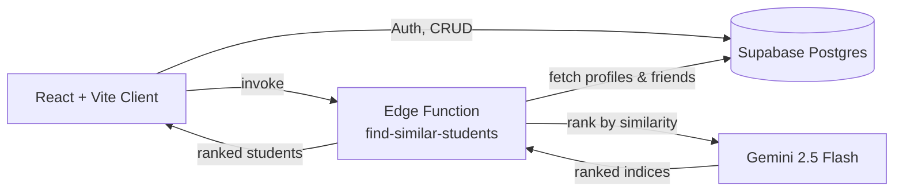

<div align="center">

# 🔄 SkillSwap

### Team up, learn skills, and build projects together.

A campus platform where students find teammates, match on skills, and join hackathons, powered by AI-driven peer matching.

<br/>


[Features](#-features) • [Tech Stack](#-tech-stack) • [Architecture](#-architecture) • [Getting Started](#-getting-started) • [Database](#-database-schema) • [Roadmap](#-roadmap)

</div>

---

## ✨ Overview

Great projects start with the right team, but finding people with complementary skills on a big campus is hard. **SkillSwap** fixes that. Students sign up with their college email, list their skills, and get **AI-ranked suggestions** of peers to connect with. From there they can form teams, register for events, and build together.

---

## 🚀 Features

| | Feature | Description |
|---|---|---|
| 🤝 | **Find Teammates** | Discover students from your college who complement your skills |
| 🧠 | **AI Skill Matching** | Gemini ranks peers by skill overlap, branch similarity, and year |
| 🏆 | **Hackathons & Events** | Browse events and register as an individual or as a team |
| 👥 | **Team Builder** | Create teams, list needed roles and skills, and let others join |
| 💬 | **Friends & Messaging** | Send friend requests, accept or decline, and chat with connections |
| 👤 | **Student Profiles** | Showcase your branch, year, and skills |
| 🔐 | **College-gated Auth** | Sign-up and login restricted to verified student emails |
| 🛡️ | **Row-Level Security** | Students only see peers from their own college |

---

## 🧰 Tech Stack

**Frontend**
- ⚛️ React 18 + TypeScript, built with Vite
- 🎨 Tailwind CSS + shadcn/ui (Radix UI primitives)
- 🧭 React Router v6
- 🔄 TanStack Query for data fetching and caching
- 📝 React Hook Form + Zod for validation
- 🔔 Sonner toasts and Lucide icons

**Backend**
- 🟢 Supabase (PostgreSQL, Auth, Row-Level Security)
- ⚡ Supabase Edge Functions (Deno)
- 🤖 Google Gemini 2.5 Flash (via Lovable AI Gateway) for similarity ranking

---

## 🏗️ Architecture



### 🧠 How AI matching works

The `find-similar-students` edge function:

1. Loads the current student's profile (branch, year, skills).
2. Fetches all other students from the **same college**, excluding existing friends.
3. Prompts Gemini to rank them by, in priority order:
   - Exact skill matches
   - Semantic skill similarity (e.g. `C/C++` ≈ `C Programming`)
   - Same year
   - Branch similarity (e.g. `Computer Science` ≈ `Software Engineering`)
4. Returns the ranked list, with a safe fallback to the original order if parsing fails.

---

## 📁 Project Structure

```
teamup-skillswap/
├── src/
│   ├── components/
│   │   ├── LandingPage.tsx       # Marketing landing page
│   │   ├── LoginPage.tsx / SignupPage.tsx
│   │   ├── Layout.tsx            # App shell + navigation
│   │   ├── Dashboard.tsx
│   │   ├── FriendsPage.tsx       # AI-suggested peers + requests
│   │   ├── TeamsPage.tsx         # Browse and manage teams
│   │   ├── CreateTeam.tsx / JoinTeam.tsx
│   │   ├── Events.tsx / View.tsx # Event list + details
│   │   ├── Registration.tsx / TeamRegister.tsx
│   │   ├── MessagesPage.tsx
│   │   ├── ProfilePage.tsx
│   │   └── ui/                   # shadcn/ui components
│   ├── contexts/AuthContext.tsx  # Supabase session management
│   ├── integrations/supabase/    # Client + generated types
│   ├── lib/allowedEmails.ts      # Allowed student email list
│   └── pages/                    # Index, NotFound
├── supabase/
│   ├── functions/find-similar-students/   # AI matching edge function
│   └── migrations/                        # SQL schema + RLS policies
└── public/
```

---

## 🧭 App Routes

| Route | Page |
|---|---|
| `/` | Landing page |
| `/login`, `/signup` | Authentication |
| `/dashboard` | Student dashboard |
| `/friends` | Friends and AI-suggested peers |
| `/teams` | Teams |
| `/events` | Events and hackathons |
| `/view/:eventId` | Event details |
| `/registration/:eventId` | Individual registration |
| `/teamregister/:eventId` | Team registration |
| `/createteam/:eventId` | Create a team for an event |
| `/jointeam/:eventId` | Join an existing team |
| `/messages` | Messaging |
| `/profile` | Profile and skills |

---

## 🗄️ Database Schema

| Table | Purpose |
|---|---|
| `colleges` | Colleges (name, location) |
| `studentdetails` | Student profile: name, email, college, year, branch, skills |
| `friends` | Friend connections with `pending` / accepted status |
| `teams` | Team info: members, needed roles, skills, tags, difficulty, deadline |
| `events` | Events: date, location, deadline, required skills, individual and team registrations |

A database trigger (`link_user_to_student_record`) links a new auth user to their existing student record by email, and RLS policies limit visibility to students from the same college.

---

## ⚙️ Getting Started

### Prerequisites
- Node.js 18+ and npm
- A [Supabase](https://supabase.com) project
- [Supabase CLI](https://supabase.com/docs/guides/cli) (for migrations and edge functions)

### 1. Clone and install

```bash
git clone https://github.com/<your-username>/teamup-skillswap.git
cd teamup-skillswap
npm install
```

### 2. Configure environment variables

Create a `.env` file in the project root:

```env
VITE_SUPABASE_URL=your_supabase_project_url
VITE_SUPABASE_PUBLISHABLE_KEY=your_supabase_anon_key
VITE_SUPABASE_PROJECT_ID=your_supabase_project_id
```

### 3. Set up the database

```bash
supabase link --project-ref <your-project-id>
supabase db push
```

### 4. Deploy the AI matching function

```bash
supabase secrets set LOVABLE_API_KEY=your_lovable_api_key
supabase functions deploy find-similar-students
```

### 5. Run the app

```bash
npm run dev
```

Open the local URL printed in the terminal (Vite's default is `http://localhost:5173`).

### Scripts

| Command | Description |
|---|---|
| `npm run dev` | Start the dev server |
| `npm run build` | Production build |
| `npm run preview` | Preview the production build |
| `npm run lint` | Run ESLint |

---

## 🔒 Access Control

Sign-up and login are limited to student emails listed in `src/lib/allowedEmails.ts`. Replace the mock addresses with your college's real student list or domain check before deploying.

---

## 🗺️ Roadmap

- [ ] Real-time messaging with Supabase Realtime
- [ ] Skills-to-learn and "swap" matching
- [ ] AI-suggested teams for each event
- [ ] Project showcase and achievements on profiles
- [ ] Notifications for friend requests and team invites
- [ ] Domain-based college email verification

---

## 🤝 Contributing

Contributions are welcome!

1. Fork the repository
2. Create a feature branch: `git checkout -b feature/amazing-feature`
3. Commit your changes: `git commit -m "Add amazing feature"`
4. Push the branch: `git push origin feature/amazing-feature`
5. Open a Pull Request

---

## 📄 License

Distributed under the MIT License. Add a `LICENSE` file to the repo to match.

---

<div align="center">

**Built with ❤️ for students who build together.**

⭐ Star this repo if you found it useful!

</div>
